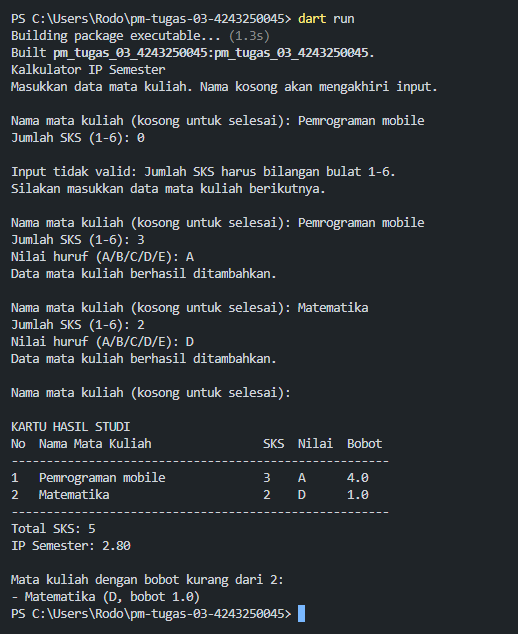

# Kalkulator IP Semester

## Identitas mahasiswa

Nama: Rodo Lemuel Nadeak
Kelas: PSIK 24C
NIM: 4243250045

## Deskripsi

Program Dart Console untuk memasukkan mata kuliah, memvalidasi SKS dan nilai
huruf, menghitung IP semester, serta menampilkan Kartu Hasil Studi (KHS).
Konversi nilai mengikuti modul: A=4, B=3, C=2, D=1, dan E=0. SKS yang diterima
adalah bilangan bulat 1-6. Input nama mata kuliah kosong mengakhiri pengisian.

## Cara menjalankan

Pastikan Dart SDK tersedia, lalu buka terminal pada folder project dan jalankan:

```shell
dart run
```

Masukkan nama mata kuliah, SKS, dan nilai huruf untuk setiap mata kuliah.
Untuk mengakhiri input dan melihat KHS, tekan Enter saat diminta nama mata
kuliah. Jika input SKS atau nilai tidak valid, program menampilkan pesan error
dan melanjutkan input.

## Higher-order functions dan error handling

Program menggunakan `fold` untuk mengakumulasi total bobot tertimbang (SKS dikali bobot) dan total SKS, kemudian membagi keduanya untuk memperoleh IP. Jika total SKS nol, fungsi perhitungan mengembalikan nilai kosong sehingga program menampilkan keterangan bahwa IP belum dapat dihitung, bukan melakukan pembagian dengan nol. Fungsi `where` memilih mata kuliah dengan bobot di bawah 2 untuk ditampilkan pada bagian khusus KHS. Sebelum KHS dicetak, `sort` mengurutkan salinan daftar mata kuliah dari bobot tertinggi; nilai yang sama diurutkan menurut nama agar hasilnya konsisten. Validasi memeriksa SKS 1-6 serta nilai A, B, C, D, atau E setelah trim dan normalisasi huruf kapital. Input yang tidak valid melempar `FormatException`. Blok `try-catch` di `main` menangani exception, menampilkan alasannya, dan melanjutkan perulangan sehingga data sebelumnya tetap tersimpan dan pengguna masih dapat memasukkan mata kuliah lain.

## Screenshot sesi program

Screenshot belum dilampirkan agar tidak menggunakan gambar simulasi. Untuk
membuat screenshot asli:

1. Jalankan `dart run` di terminal VS Code.
2. Masukkan satu data dengan SKS atau nilai yang tidak valid, lalu masukkan
   setidaknya satu data valid untuk menunjukkan program tetap berjalan.
3. Akhiri input dengan nama mata kuliah kosong agar tabel KHS terlihat.
4. Tekan `Win+Shift+S`, pilih area terminal yang menampilkan error dan KHS,
   lalu simpan gambar sebagai `screenshot/uji_kalkulator_ip.png`.
5. Setelah membuat file tersebut, tambahkan gambar ke README dengan:
   ``.

## Screenshot Pengujian

